# StarHealth Data Breach: Insider threat or smoke and mirrors?

## Breach Timeline

**Breach Confirmed | September 22, 2024**

On September 22, 2024, the threat actor "xenZen" made a post on BreachForums claiming to possess data of 31 million customers of StarHealth insurance.

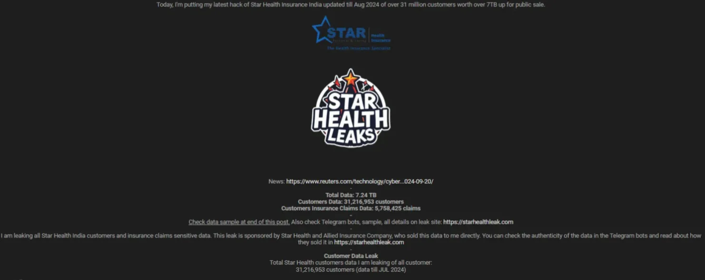

**Telegram Lawsuit | September 26, 2024**

StarHealth sued Telegram and Cloudflare because the threat actor was using Cloudflare for his site and Telegram to host bots to serve and sell the breached data. As a result, Telegram took down the bots and channels, and the site was also taken down.

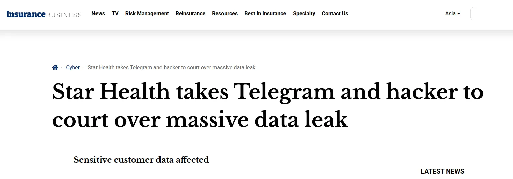

**Resurfacing | Sometime after September 26, 2024**

The breached data resurfaces on a mirror site hosted by the threat actor.

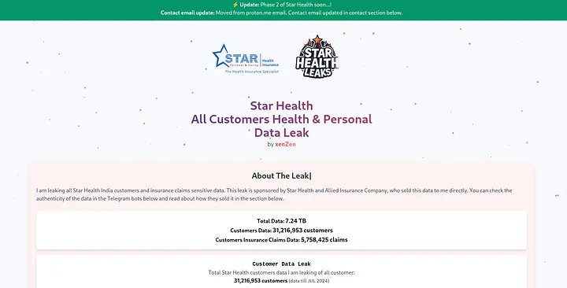

---

## Allegations by the Threat Actor

On the breach site, the TA alleges that the CISO (Chief Information Security Officer) of StarHealth Insurance sold him the data with some of the senior management also involved. As "evidence", the TA provided a screen recording of their chats on TOX under the name "mc6" and emails exchanged between them.

According to the emails, the CISO initiated the conversation by offering the data. They negotiated the price and finally agreed on a price of 28,000 USD in Monero (XMR).

Then the CISO emailed the credentials of an account and portal to the TA.

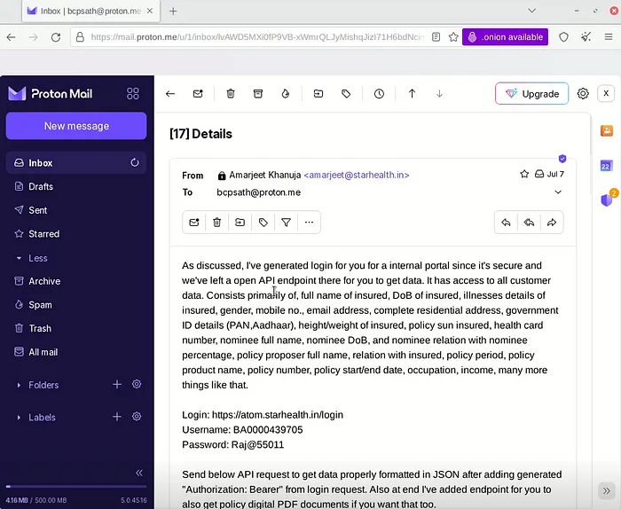

Following this, the CISO provides the TA his XMR address and the TA pays 15,000 USD. There is no way to confirm whether this payment was ever made or its more smoke and mirrors as XMR anonymizes all payments.

Following this payment, the CISO provides the TA access to another portal and APIs he can use to retrieve the data.

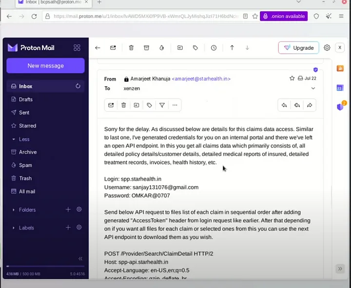

After sometime, the TA complains that access has been revoked and no more data is coming. In response, the CISO demands 150,000 USD for "senior management". Then the deal between them goes sour.

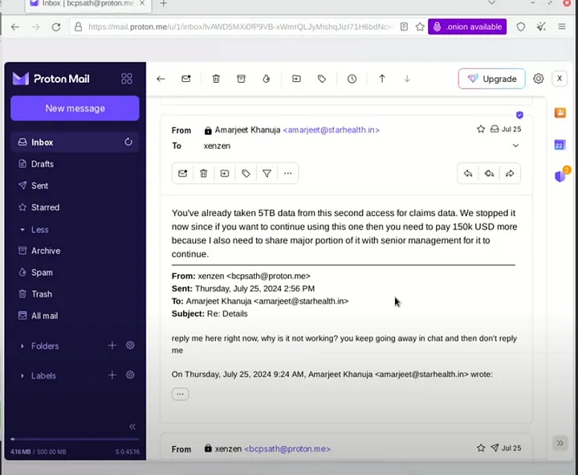

---

## My Analysis: Why This Looks Suspicious

Blaming the CISO for selling the data seems like a strategic red herring aimed at damaging both the brand and the CISO's reputation. I also have many reasons to believe this:

1. **Real Name and Work Email**: As you too would have observed, the CISO was allegedly using his work email with his real name for something very very illegal. Kids and teens are taught to not use their real names when talking with strangers online, and thinking a cybersecurity professional wouldn't simply utilize a disposable email address is absurd. The use of the work email itself too is just an extra step as the login credentials could have been very well exchanged using TOX. It is trivially easy to spoof email headers to show as if the emails were coming from the CISO. Even a simple inspect element could have been used to fake this.

   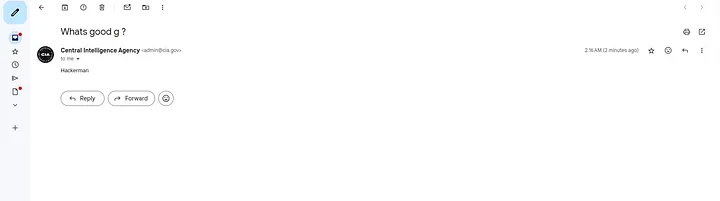

   Well if you think the emails from CISO were real, then you should believe that langley and me are friends.

2. **Bad Fakes**: The login page (atom.starhealth.in) the TA claimed to access (the first one) requires an OTP for login before the password. However, no OTP was exchanged between the TA and the CISO in the recording.

   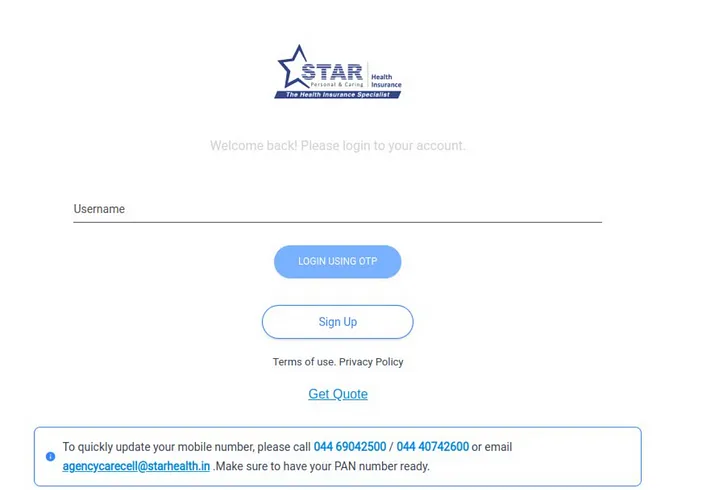

3. **Email Shenanigans**: The email that the TA was allegedly given by the CISO (sanjay131076@gmail.com) was already compromised and had credentials obtained using info stealer malware floating around.

   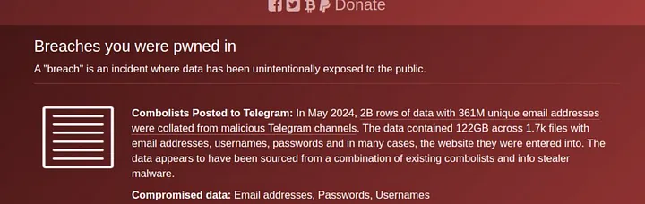

4. **Financial Repercussions**: A data breach, caused by an insider threat or not, carries a penalty of up to 250 crore INR under the DPDP Act. It would also jeopardize the career of the CISO, which as the job title suggests is responsible for information security. Risking such losses for a measly 150,000 USD (1.25 crore INR) seems foolish.

I believe this was yet another breach where info stealer logs provided initial access. After getting initial access due to the lack of 2FA in some portal or the other, a vulnerability in the system like IDOR or SQL could have provided the data. The TA claimed to use APIs to obtain the data so IDOR seems more plausible.

---

## About the Threat Actor: xenZen

xenZen is a prolific threat actor, known for targeting Indian companies, most notably being responsible for the Airtel and Ministry of External Affairs breaches.

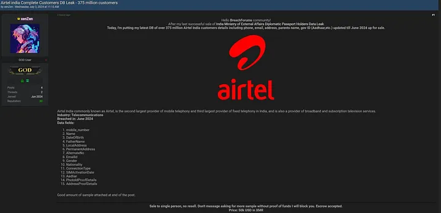
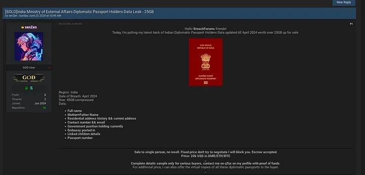

```
# Threat Actor Profile
session_id = "0587cdb863c2bf89de2b047312f08022fb7d189d2e62c0069e626a9d66becaae5e"
emails = [
    "bcpsath@airmail.cc",
    "bcpsath@proton.me"
]
claimed_location = "China"  # Likely false

# Additional Details from Breachforums Database
username = "Xenza"
alternative_email = "xenzen8@gmail.com"
last_ip = "36.81.210.5"
last_geographic_location = "Indonesia, Jawa Timur, Mojoagung"

# Online Presence
tox_id = "0587cdb863c2bf89de2b047312f08022fb7d189d2e62c0069e626a9d66becaae5e"
youtube_channel = "https://www.youtube.com/@Lexie-z4i"
```

On his Breachforums profile, xenZen claims to reside in China, which can very well be a lie. The profile picture xenZen uses on Breachforums is an AI-generated image taken from Freepik.

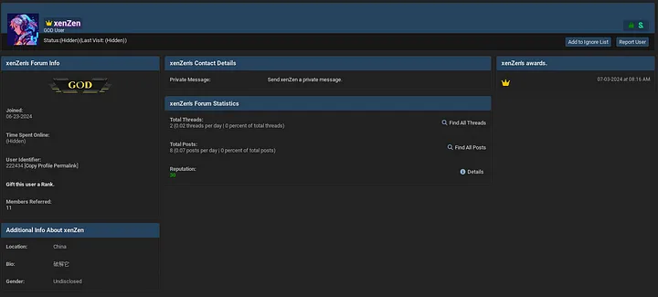
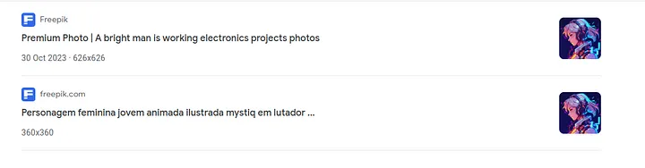

Looking through the Breachforums databreach, which was leaked a while ago by another threat actor "emo" we find this record in the user database

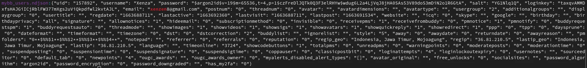

Conducting OSINT on the email reveals it was also breached in the Canva breach where the username of the account was "Xen Zen". On the individual's Google Maps profile, we see reviews and photos for places in Indonesia. However, this individual may or may not be the xenZen who was responsible for the breach.

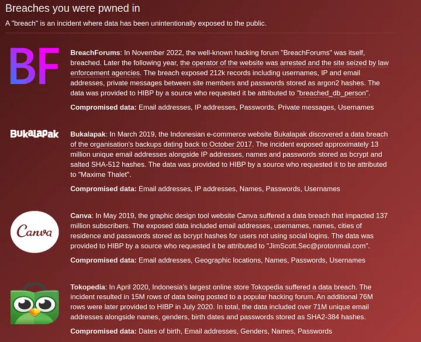

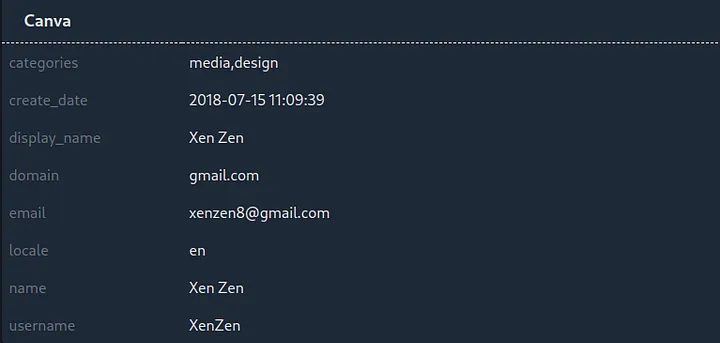

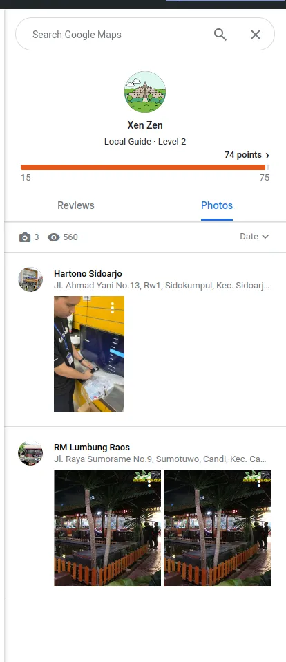

---

## Blog Update 1: October 12th 2024

xenZen is a pathetic liar, stealer logs were indeed used for initial access.

I decided to look through my own vast well of scraped stealer logs for evidence of the stealer log theory, and voila, I found the credentials the TA xenZen claimed to have used.

```
# Claimed Credentials
login_1 = {
    "site": "https://atom.starhealth.in/login",
    "username": "BA0000439705",
    "password": "Raj@55011"
}

login_2 = {
    "site": "spp.starhealth.in",
    "username": "sanjay131076@gmail.com",
    "password": "OMKAR@0707"
}
```

I established earlier that the sanjay13017 email was already compromised. After searching through my own database, I now know when exactly and how these accounts were compromised.

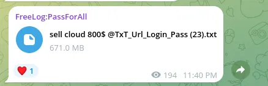

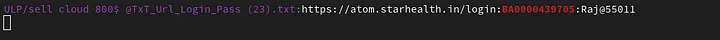

---

## Blog Update 2: October 12th 2024

More intel: The TA's Proton ID (bcpsath@proton.me) was created (or the key was updated) on June 22, 2024, at 5:03:41 PM IST.

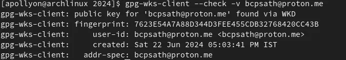

The TA's other email, bcpsath@airmail.cc, is provided by the email provider cock.li

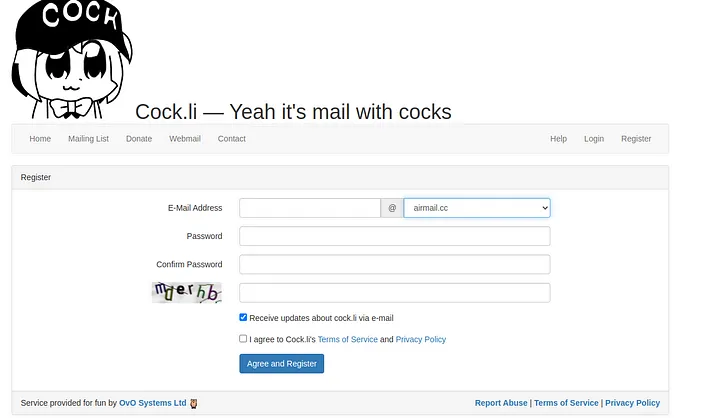

---

## Blog Update 3: October 13th 2024

StarHealth Insurance, the victim, has recently submitted a filing to the BSE in which it has claimed that the TA or some associate with the TA had tried to extort 68,000 USD out of them.

StarHealth claims that the two emails that were used to try to extort them were:

- vladislav5511@outlook.com
- vladislav5533@outlook.com

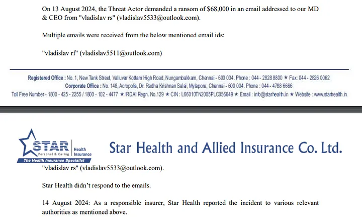

To me, this seems like another red herring intended to mislead investigators by posing as Russian, and there's one key reason I believe this: The TA has no presence on any Russian-speaking cybercrime forum, at least none under the name xenZen.

Nothing on exploit

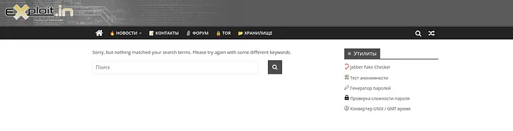

Only a post on club2card mentioning xenZen, which is nothing but a Russian translation of the NDTV article of the Telegram-Starhealth lawsuit.

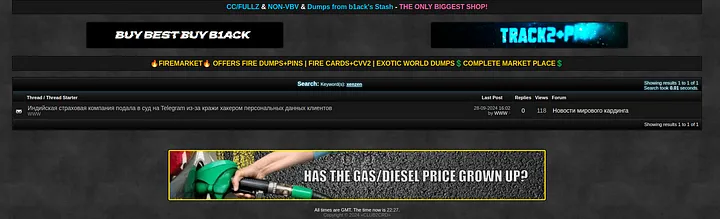

Performing OSINT on these emails does not yield much, except that these emails might have been used on the image hosting platform Imgur (which I believe is a false positive result of Holehe, the tool I used).

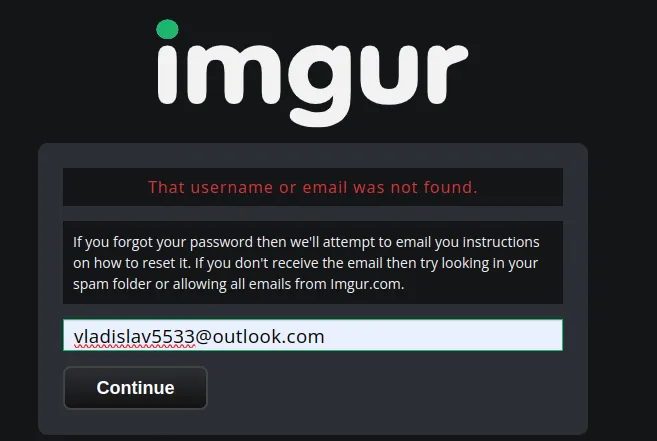

Conducting metadata analysis on the two GIFs and pictures used by the TA on the leaks website also yields rather uninteresting results. We can see that the TA used ezgif to create those GIFs.

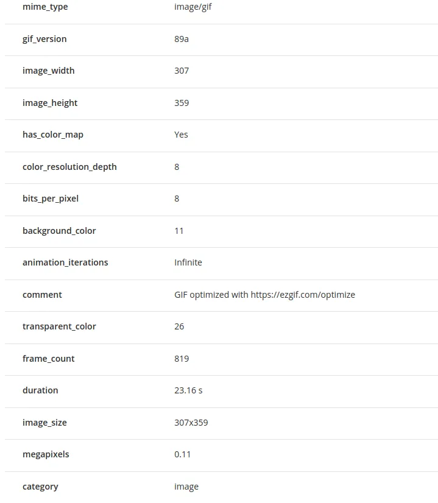

---

And that's the end of my sort of deep dive into the StarHealth incident. If you found it good or I got something wrong, let me know!